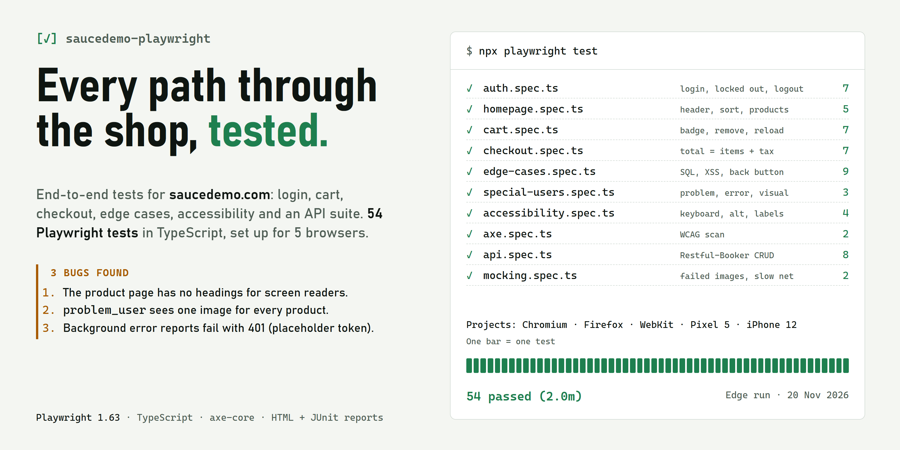
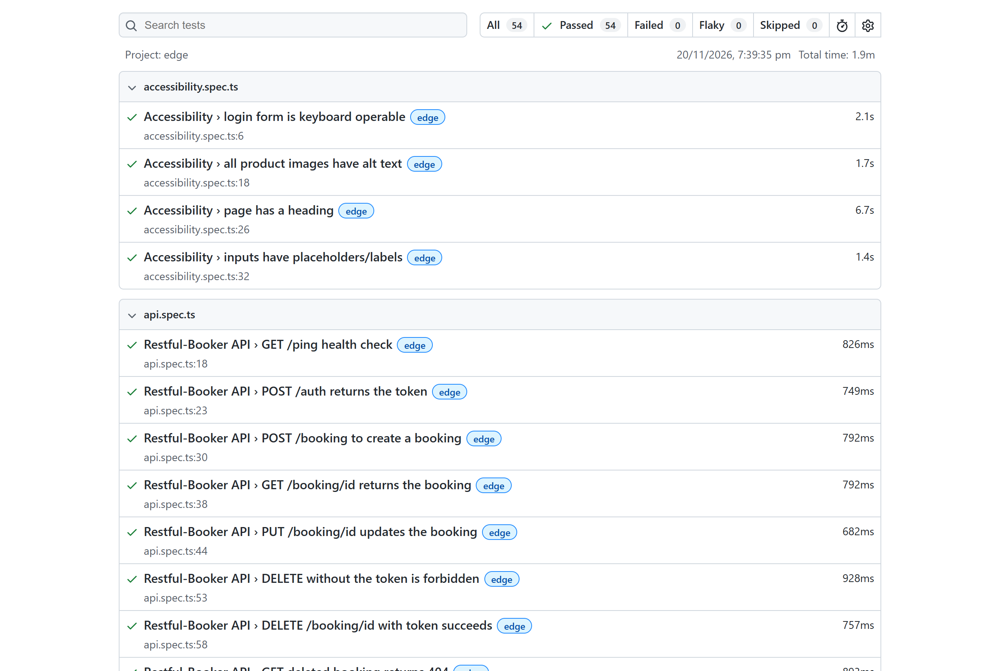

<picture>
  <source media="(prefers-color-scheme: dark)" srcset="docs/images/banner-dark.png">
  
</picture>

# SauceDemo: end-to-end tests with Playwright

54 Playwright tests in TypeScript for [saucedemo.com](https://www.saucedemo.com), a demo shop made for test practice. They cover login, the product list, the cart, checkout, edge cases, special users, accessibility, network mocking, and a separate API suite.

<p>
  <a href="https://github.com/dheekshithsnewjourney-crypto/saucedemo-playwright/actions/workflows/tests.yml"></a>
  <a href="./LICENSE"></a>
</p>

## What is covered

| File | Tests | What it checks |
|---|---|---|
| `auth.spec.ts` | 7 | Login, wrong password, empty fields, locked-out user, logout |
| `homepage.spec.ts` | 5 | Header, menu, sort filter, product list, product details, footer links |
| `cart.spec.ts` | 7 | Add and remove items, cart badge, cart page, reload |
| `checkout.spec.ts` | 7 | Full purchase, missing-field errors, total = items + tax, cancel |
| `edge-cases.spec.ts` | 9 | SQL-style and XSS input, long and padded usernames, wrong case, back button after logout, blocked deep links |
| `special-users.spec.ts` | 3 | `error_user`, `problem_user` and `visual_user` behaviour |
| `accessibility.spec.ts` | 4 | Keyboard login, image alt text, headings, field labels |
| `axe.spec.ts` | 2 | Automatic WCAG scan with axe-core (login and product pages) |
| `api.spec.ts` | 8 | [Restful-Booker](https://restful-booker.herokuapp.com) API: create, read, update, delete, with and without a token |
| `mocking.spec.ts` | 2 | Every image fails to load; a slow network |

Shared login helpers are in `tests/helpers.ts`. The password in it, `secret_sauce`, is the public demo password that saucedemo.com shows on its own login page.

## Last full run



54 of 54 passed in Microsoft Edge on 20 November 2026 (1.9 minutes). CI runs the suite in Chromium on every push.

## Bugs found

1. The product page has no semantic headings (`h1` to `h6`), so screen-reader users cannot move by heading.
2. `problem_user` sees the same image for every product.
3. The site sends background requests to `events.backtrace.io` with placeholder values (`universe=UNIVERSE&token=TOKEN`) and gets 401.

## Browsers

The config has 5 projects: Chromium, Firefox, WebKit, Pixel 5 and iPhone 12 (mobile emulation). It runs one test at a time, because Firefox froze at random steps when several browsers ran together. On a failure it keeps a trace, a screenshot and a video. It writes an HTML report and a JUnit file (`results.xml`) for CI tools.

## Run it

You need Node 22 or newer.

```bash
npm install
npx playwright install
npm run test:chromium      # one browser, fastest
npm test                   # all 5 projects
npm run test:firefox       # Firefox only
npm run test:firefox:headed  # Firefox with a visible window, if headless Firefox hangs
npm run test:ui            # Playwright UI mode
npm run report             # open the last HTML report
```

## Built with

Playwright 1.63, TypeScript, @axe-core/playwright, GitHub Actions.

## Contributing

Ideas and bug reports are welcome: read [CONTRIBUTING.md](./CONTRIBUTING.md). For a security problem, follow [SECURITY.md](./SECURITY.md).

## License

[MIT](./LICENSE).
